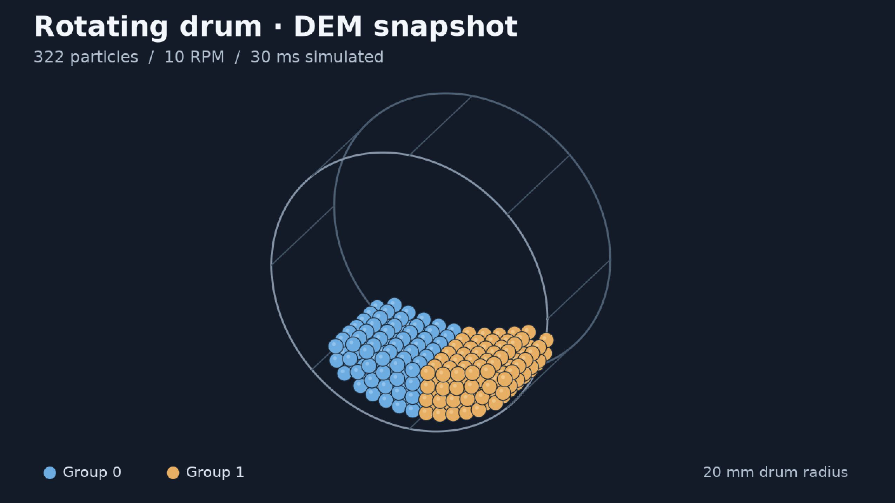

# PharmaParticleSim

PharmaParticleSim is a C++ discrete element method (DEM) simulator for spherical particles with Hertz–Mindlin contact in a rotating drum. It also explores whether a PyTorch graph model can advance the same system in 50 µs jumps, ten times the 5 µs DEM timestep, while retaining useful trajectory and mixing accuracy.



*Classical DEM snapshot at 30 ms from the seed-44 drum example. Colors distinguish the two simulated particle groups.*

## Results

| Seed-44 development run | Simulated time | Position RMSE | Velocity RMSE | Spin RMSE | Measured CPU speedup |
|---|---:|---:|---:|---:|---:|
| Gated processor, historical benchmark | 10 ms | 68.9 µm | 0.01375 m/s | 9.72 rad/s | **1.264×** |
| Four-prediction fine-tuned checkpoint | 50 ms | 241.2 µm | 0.02430 m/s | 28.31 rad/s | — |
| Same fine-tuned checkpoint, extended rollout | 1 s | 1.987 mm | 0.00711 m/s | 10.99 rad/s | — |

RMSE is measured against the classical simulator and pooled over particle components at the endpoint. The historical timing compares **192.3 ms for C++ DEM with 152.2 ms for ML**, using the median of five paired CPU runs on 322 particles. Both simulated the same 10 ms interval, and timing excluded file I/O and diagnostics. The 10 ms accuracy figures come from a preceding run of the same optimized model. The fine-tuned checkpoint was evaluated for accuracy separately.

The C++ implementation also matched recorded LAMMPS results for selected head-on, oblique, and flat-wall collision cases. [LAMMPS reference cases](https://github.com/emilyober/pharmaparticlesim/tree/ml-rollout-finetune/benchmarks/reference/lammps) · [CPU timing method and data](https://github.com/emilyober/pharmaparticlesim/blob/ml-rollout-finetune/experiments/summaries/benchmark_early_gate_ghosts.md) · [Rollout and fine-tuning logs](https://github.com/emilyober/pharmaparticlesim/blob/ml-rollout-finetune/experiments/summaries/ml_seed44_baseline.md)

## Build and run the C++ simulator

Use CMake 3.16 or later and a C++17 compiler. Run from the repository root on `main` so the executable can find `materials.csv` and `contacts.csv`.

```sh
cmake -S . -B build -DCMAKE_BUILD_TYPE=Release
cmake --build build --parallel
./build/pharmaparticlesim
```

This runs the drum example and writes `drum_test.csv`. The C++ executable uses the scenario defined in `src/main.cpp`.

## Run the 322-particle example and viewer

The ML development branch includes the seed-44 drum example, viewer, Python evaluator, and experiment records. From the repository root:

```sh
git switch ml-rollout-finetune
mkdir -p experiments/results/local_timestepping
cmake -S . -B build -DCMAKE_BUILD_TYPE=Release
cmake --build build --parallel
./build/pharmaparticlesim
```

This example writes `experiments/results/local_timestepping/benchmark_seed44.csv`. To view it, install raylib where CMake can find it, then run:

```sh
cmake -S viewer -B build-viewer -DCMAKE_BUILD_TYPE=Release
cmake --build build-viewer --parallel
./build-viewer/dem_viewer experiments/results/local_timestepping/benchmark_seed44.csv
```

Press **Space** to pause or resume and **R** to restart.

## Run the ML evaluation

On `ml-rollout-finetune`, use Python 3.13 and the pinned dependencies in `requirements-ml.txt`. The checked-in 70 ms evaluator requires both seed-44 trajectories below in `experiments/results/local_timestepping/`. The short example above produces a different CSV.

- `pilot_seed44_10rpm_0p1s_dense.csv` for fine-step DEM history
- `pilot_seed44_10rpm_6s_sparse.csv` for comparisons at recorded steps

These files are local experiment outputs and are required before running the evaluator. The checkpoint path is set near the top of `ml/eval_long_rollout.py`. At the recorded baseline commit, it selects the matched eight-prediction checkpoint. To compare the matched four-prediction checkpoint, change only that path.

```sh
python3.13 -m venv .venv
.venv/bin/python -m pip install -r requirements-ml.txt
.venv/bin/python ml/eval_long_rollout.py
```

## Limitations

- The speedup is a CPU compute-time result for one checkpoint, particle count, and short window at equal simulated duration. GPU speedup, particle-count scaling, and speed at matched accuracy remain unmeasured.
- The longer rollouts show drift in particle positions, rotational energy, and mixing metrics. Seed 44 is a development trajectory. Full-revolution mixing accuracy and acceptance on untouched trajectories remain open.
- The extended rollouts used fixed screening limits measured from the first 50 ms pilot window. Model overlaps were measured at prediction endpoints. Sparse DEM frames support comparisons only at their recorded steps.
- The LAMMPS checks cover specific contact cases. Validation for rotating-wall contacts and experimental powder mixing remains open.
