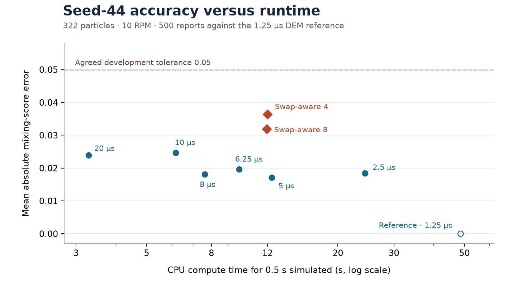

# PharmaParticleSim accuracy–runtime comparison

Seed-44 CPU development benchmark · November 2026

## Historical workload, measured again

The workload used 322 particles at 10 RPM, from physical time 0.030 to 0.040 s. The Release C++ DEM ran 2,000 updates at 5 µs. Each ML checkpoint ran 200 predictions at 50 µs, from dense DEM history and state at steps 5990 and 6000. One warmup and five timed runs per method were executed serially on the same Darwin arm64 host. ML used one PyTorch CPU thread, early gating, and inference mode. Timings exclude loading, trajectory metrics, and CSV output during the timed window. The historical ML checkpoint used its original integration settings. The current checkpoints used their saved gravity correction and contact-position settings.

| Method | Median CPU time | Range | DEM / ML | Endpoint position RMSE | Velocity RMSE | Spin RMSE |
|---|---:|---:|---:|---:|---:|---:|
| C++ DEM, 5 µs | 203.94 ms | 200.09–214.46 ms | — | Reference | Reference | Reference |
| Historical gated ML | 160.84 ms | 157.73–178.68 ms | 1.268× | 68.92 µm | 0.01375 m/s | 9.72 rad/s |
| Clean swap-aware four | 163.97 ms | 160.38–181.86 ms | 1.244× | 66.55 µm | 0.01323 m/s | 10.34 rad/s |
| Clean swap-aware eight | 164.82 ms | 159.52–167.33 ms | **1.237×** | 61.49 µm | 0.01312 m/s | 10.20 rad/s |

The C++ executable came from the committed benchmark scenario on `ml-rollout-finetune`. The historical checkpoint reproduced the previously reported endpoint RMSE. The current eight-prediction checkpoint used 19.2% less compute time than 5 µs DEM in this 10 ms workload. This comparison matches simulated time. Mixing accuracy is evaluated separately below.

## Broader training and longer validation

Seed-42, 45, and 46 dense pilots are available through 0.1 s. They vary initial positional jitter at the same RPM, materials, and particle count. A previous 1,000-example experiment redistributed its fixed budget across these seeds and did worse under the old architecture. That result leaves open what happens when the original seed-42 examples are retained and new data are added.

The current clean checkpoints were re-evaluated on four seed-43 windows of 400 predictions (20 ms), starting at DEM steps 2000, 6000, 10000, and 14000. Both completed every window using per-window dense DEM overlap limits. Lower normalized rollout scores are better.

| Start step | Swap-aware four | Swap-aware eight |
|---|---:|---:|
| 2000 | 99.43 | 94.84 |
| 6000 | 310.86 | 264.98 |
| 10000 | 156.98 | 140.63 |
| 14000 | 209.80 | 196.10 |
| Mean | 194.27 | 174.14 |

Use these windows in both conditions of the next clean training experiment. Keep the swap-aware eight architecture and 50 µs inference interval fixed. Retain the 997 seed-42 examples and add 997 valid examples from each of seeds 45 and 46, sampled reproducibly within each trajectory before applying concatenation offsets. For an update-matched seed-42 control, repeat its existing 997 indices three times per epoch. Use the same initialization, optimizer schedule, shuffle seed, and number of updates in both conditions. These pilots broaden initial jitter coverage. Longer dense windows at later mixing stages would broaden the range of contact histories.

The planned learned-horizon grid was 25, 50, and 100 µs. Use history and targets at 5, 10, and 20 fine DEM steps, respectively, and set the model's physical timestep to match. Use the same physical training start times and a 0.4 ms training window (16, 8, or 4 predictions), plus the same 20 ms validation windows (800, 400, or 200 predictions). Keep wall and material settings fixed. Preserve fine DEM history at each required initial offset. The matched 50 and 100 µs experiments are recorded below. The 25 µs checkpoint remains untrained.

## 0.5 s mixing-error and runtime sweep

*Initial sweep with the unpatched classical solver. The flat-grid results are recorded separately below.*

All methods simulated the seed-44 drum over physical time 0.030–0.530 s. Each classical run started from the same seeded particle initialization at time zero and warmed up with its own timestep. The learned runs used the fine reference states at 0.02995 and 0.030 s as history and initial state. Timing excludes warmup, loading, output, and metric calculation. The C++ sweep used an isolated Release build with timestep and timing controls. The contact and integration equations were kept the same. The 5 µs sweep state at 0.030 s matched the prior dense pilot within 7.5 × 10⁻⁹ m/s in velocity and 1.91 × 10⁻⁶ rad/s in spin, with equal stored positions.

The agreed provisional tolerance is **mean absolute mixing-score error ≤ 0.05**. The comparison uses the existing 4 mm concentration-variance score, counting cells with at least five particles, over 500 shared reports spaced 1 ms apart. The 1.25 µs DEM curve is the comparison reference. Its mixing score ranged from approximately 0 to 0.239, with 69.7% mean coverage. Mean joint group-density TV includes all particles and is reported as a secondary metric at both bin widths.

| Method | CPU time (s) | Timed trials | Mixing MAE | Endpoint mixing error | Mean coverage | Mean group-density TV, 4 / 5 mm |
|---|---:|---:|---:|---:|---:|---:|
| DEM 20 µs | **3.282** | 3 | 0.0240 | 0.0525 | 69.8% | 0.112 / 0.077 |
| DEM 10 µs | 6.178 | 3 | 0.0247 | 0.0483 | 70.2% | 0.112 / 0.080 |
| DEM 8 µs | 7.623 | 1 | 0.0181 | 0.0286 | 71.0% | 0.117 / 0.082 |
| DEM 6.25 µs | 9.793 | 1 | 0.0196 | 0.0405 | 70.5% | 0.113 / 0.079 |
| DEM 5 µs | 12.379 | 3 | 0.0172 | 0.0147 | 71.0% | 0.110 / 0.088 |
| DEM 2.5 µs | 24.340 | 1 | 0.0184 | 0.0005 | 70.8% | 0.107 / 0.072 |
| DEM 1.25 µs reference | 48.663 | 1 | 0 by definition | 0 | 69.7% | 0 / 0 |
| ML swap-aware four, 50 µs | 11.994 | 2 | 0.0364 | 0.0719 | 72.2% | 0.170 / 0.125 |
| ML swap-aware eight, 50 µs | 11.936 | 2 | 0.0319 | 0.0488 | 71.2% | 0.165 / 0.121 |

Times are medians where repeated and single observations where indicated. The ML timings used one CPU thread and one short warmup per checkpoint. Both learned rollouts completed 10,000 predictions under full-window limits of 108.53 µm particle and 58.44 µm wall overlap, based on peaks measured at each fine DEM state. Learned peaks were checked at prediction endpoints.

- **Error under the same runtime budget.** Within the 11.94 s budget of swap-aware eight, 8 µs DEM had the lowest measured classical mixing MAE, 0.0181 in 7.62 s versus 0.0319 for ML. This uses measured points and a shared budget without interpolation.
- **Runtime at the agreed error tolerance.** Both learned runs meet the 0.05 mean tolerance. The fastest measured DEM configuration that meets it is 20 µs, at 3.28 s. That is 3.64× faster than the fastest measured ML configuration at this tolerance. The 20 µs endpoint error is 0.0525, so it would not pass a separate endpoint tolerance of 0.05.
- **Reference sensitivity.** The two finest DEM curves differ by 0.0184 mean mixing-score error. Using the 2.5 µs reference still makes 20 µs the fastest passing configuration, and a cheaper classical run still has lower error than either ML model. The best measured classical point under the ML budget changes to 6.25 µs. The sweep is a single-seed development result, with a provisional reference and mean tolerance.

This initial benchmark covers the 50 µs learned horizon and unpatched DEM. A final mixing comparison needs repeat timing near the frontier, a timestep refinement check over the intended mixing duration, and frozen acceptance criteria before evaluating untouched trajectories.

## DEM variability check

All comparisons cover the same 0.030–0.530 s interval and 500 shared 1 ms reports. Classical DEM used 5 µs in every run. A nominal seed-44 rerun reproduced the earlier 5 µs sweep states exactly. Three repeats added independent Gaussian initial position perturbations with 1 nm standard deviation per component to all 322 particles, keeping velocities and contact parameters fixed. The three perturbation draws were 101, 102, and 103. Separately, the nominal seeds 42, 44, 45, and 46 form six cross-seed DEM pairs. These seeds are development data, and the six pairs share trajectories.

The current clean swap-aware eight checkpoint used each seed's own nominal 5 µs DEM history at 0.02995 s and state at 0.030 s. All four learned rollouts completed 10,000 predictions under overlap limits derived from their own seed's full-window fine-step DEM peaks. These are accuracy runs. Parallel execution was used for the variability study and its elapsed times were excluded from the runtime benchmark.

| Comparison | Number | Median mixing MAE (range) | Median mean group-density TV, 4 / 5 mm |
|---|---:|---:|---:|
| 1 nm-perturbed DEM vs. nominal seed-44 DEM | 3 | 0.0199 (0.0166–0.0211) | 0.090 / 0.066 |
| DEM pairs across development seeds | 6 | 0.0260 (0.0238–0.0413) | 0.131 / 0.090 |
| ML vs. same-seed nominal DEM | 4 | 0.0278 (0.0229–0.0443) | 0.166 / 0.132 |

| Development seed | ML mixing MAE | Mean group-density TV, 4 / 5 mm | DEM mixing score at endpoint | ML mixing score at endpoint |
|---|---:|---:|---:|---:|
| 42 | 0.0229 | 0.173 / 0.132 | 0.1623 | 0.1537 |
| 44 | 0.0305 | 0.164 / 0.137 | 0.1113 | 0.1642 |
| 45 | 0.0251 | 0.166 / 0.127 | 0.1467 | 0.2360 |
| 46 | 0.0443 | 0.165 / 0.132 | 0.0514 | 0.1748 |

On seed 44, the ML mixing MAE exceeded all three small-perturbation DEM differences. The learned mixing score fell inside the observed range of the nominal and three perturbed DEM curves at 41.6% of reports. Across seeds, the scalar mixing errors are comparable in magnitude to DEM seed variability, while every learned mean group-density TV exceeds the largest observed cross-seed DEM value at both bin widths. The model overpredicted endpoint mixing on three of the four seeds. All four passed the provisional 0.05 curve-mean tolerance, and three would miss a separate 0.05 endpoint tolerance.

This pilot estimates sensitivity for one perturbation size at one seed and spread across a small development ensemble. The observed range is descriptive. It is not a convergence bound, a confidence interval, or a measure of 1 s trajectory correlation. Keep same-seed error, cross-seed variability, and timestep refinement separate when setting final acceptance criteria.

## Broader-data 100 µs candidate

The clean 100 µs candidate trained from the same 50 µs parent weights on 2,991 examples from seeds 42, 45, and 46, using four predictions per example. The target span was 0.4 ms. Its seed-43 screening used four 20 ms windows. Every epoch completed three windows and failed the window starting at DEM step 2000, so no screened best checkpoint was selected.

The final epoch-5 checkpoint first exceeded the seed-43 guard at prediction 195, 19.5 ms after initialization (DEM step 5900). Particle overlap was 134.57 µm against a 132.79 µm limit. The wall endpoint was below its limit. A one-step prediction initialized from clean DEM states at steps 5860 and 5880 gave 59.71 µm particle overlap versus 57.41 µm in DEM at the target. Spin RMSE fell from 23.79 rad/s in the autonomous prediction to 5.45 rad/s with clean history. All 200 clean-history predictions in that window stayed below its overlap limits. This isolates a role for accumulated state error in the observed failure.

For diagnosis, the ineligible final checkpoint also ran on the seed-44 fine-reference workload from 0.030 to 0.530 s, using 0.02990 s history. It completed all 5,000 predictions under that window's guard. Mean absolute mixing-score error was 0.0287, and mean group-density TV was 0.155 / 0.129 at 4 / 5 mm. Peak model particle and wall overlap was 54.26 / 44.57 µm. Two compute-only timings were 6.145 and 5.884 s, with a 6.015 s median. This timing remains slower than the measured 20 µs DEM configuration at 3.282 s. The result is diagnostic only because the checkpoint failed the prior validation gate. The existing 50 µs benchmark checkpoint used less training data, so it cannot isolate the effect of horizon. The matched broader-data 50 µs control is still pending.

Next, train the matched broader-data 50 µs control with the same physical start steps and 20 ms selection windows. The clean-history reset results motivate a separate 100 µs pushforward comparison aimed at rollout drift. Keep the overlap gate fixed and require a screened checkpoint before adding a 100 µs model to the accuracy–runtime frontier.

## Matched broader-data 50 µs control

The matched 50 µs control selected epoch 5 and completed all four 20 ms seed-43 validation windows. It used the same parent and all 2,991 physical training start times as the 100 µs candidate. The 200 physical one-step validation starts matched too. Both training sequences span 0.4 ms.

| Seed-43 validation window start | 50 µs normalized rollout score | 50 µs predictions completed |
|---|---:|---:|
| 2000 | 88.87 | 400/400 |
| 6000 | 231.95 | 400/400 |
| 10000 | 127.55 | 400/400 |
| 14000 | 187.70 | 400/400 |
| Mean | 159.02 | 4/4 windows |

The earlier clean 50 µs checkpoint scored 174.14 when re-evaluated on those same windows. The broader-data control also used the longer windows for checkpoint selection, so the difference does not isolate the added training data.

Both horizon candidates completed the seed-44 0.5 s diagnostic against the 1.25 µs DEM reference. The 50 µs control passed validation and the 100 µs final checkpoint did not. Runtime is the median of two compute-only trials per model.

| Seed-44 metric | Matched 50 µs control | 100 µs final checkpoint, diagnostic |
|---|---:|---:|
| CPU time (s) | 12.314 | 6.015 |
| Mean absolute mixing-score error | 0.0328 | 0.0287 |
| Mean joint group-density TV, 4 / 5 mm | 0.148 / 0.113 | 0.155 / 0.129 |
| Model peak particle / wall overlap (µm) | 54.26 / 33.75 | 54.26 / 44.57 |
| Seed-43 validation windows completed at evaluated epoch | 4/4 | 3/4 |

The wider horizon roughly halved compute time in the diagnostic. Its group-density error was higher, and its seed-43 failure excludes it from the screened frontier. The 50 µs control met the provisional 0.05 mean mixing-error tolerance and took longer than 20 µs DEM at 3.28 s. Retain the 50 µs control and use the 100 µs validation failure as the target for a matched pushforward training experiment.

## Flat-grid classical baseline

The supplied `flat_grid_neighbor_search.patch` applied cleanly to local `main` and to the historical timing source on `ml-rollout-finetune`. Its SHA-256 is `dfcbcddcdbe4fa0a8cc8fc9247eaa8130f85ecff2f899fefc721bee59d26d341`. It replaces the per-step ordered-map cell search with a dense linked-cell grid. Contact resolution and material lookup were held fixed.

Both variants were compiled in Release mode from scratch copies with identical timing and output instrumentation. The 322-particle seed-44 drum used 5 µs DEM steps and 50 µs ML predictions. The 30–40 ms window matches the historical workload. The 400–410 ms window is a representative later dense-bed window. All timing excludes startup, trajectory output, and diagnostics. The solvers ran serially with warmup and alternating within-family trial order. ML used one CPU thread.

| 10 ms window | Trials per method | Original DEM | Patched DEM | Historical ML | Clean swap-aware eight |
|---|---:|---:|---:|---:|---:|
| 30–40 ms | 5 | 233.30 ms | **44.82 ms** | 170.98 ms | 173.04 ms |
| 400–410 ms | 3 | 302.49 ms | **111.88 ms** | 266.64 ms | 276.95 ms |

The classical improvement was 5.21× in the early window and 2.70× in the dense window. Patched DEM was 3.86× faster than clean swap-aware eight in the early window and 2.48× faster in the dense window. Early maximum per-particle position differences between the two classical runs were 3.28 × 10⁻¹⁶ m at 30 ms and 5.93 × 10⁻¹³ m at 40 ms. At 400 ms, the classical trajectories differed by 0.176 mm component position RMSE, with a 2.74 mm maximum particle displacement between runs. The patch changes contact accumulation order, so the early agreement does not establish pointwise equivalence after long warmup.

For the 0.5 s accuracy–runtime pilot, the two classical variants were timed at 20 µs for three paired trials. Mixing used the same fine 1.25 µs reference and 500 reports. The 0.05 tolerance is on mean mixing error. The learned row comes from its earlier timing session on the same host and workload.

| Method over 0.5 s | Median compute time | Mean mixing error | Endpoint mixing error | Mean group-density TV, 4 / 5 mm |
|---|---:|---:|---:|---:|
| Original DEM, 20 µs | 3.764 s | 0.0240 | 0.0525 | 0.112 / 0.077 |
| Patched DEM, 20 µs | **1.301 s** | **0.0184** | **0.0178** | 0.110 / 0.079 |
| Clean swap-aware eight, 50 µs | 11.936 s | 0.0319 | 0.0488 | 0.165 / 0.121 |

Patched 20 µs DEM was 2.89× faster than its paired classical control. It met the provisional mean mixing tolerance and would also meet a 0.05 endpoint tolerance on this seed. It took about one ninth of the previously measured learned compute time. The matched patch timings supersede unpatched DEM as the baseline for this development workload. Broader regression and timestep checks remain necessary before treating the optimized solver as a general reference. No changes were applied to the project checkout.

## Matched 100 µs pushforward training

The pushforward run matched the clean 100 µs run in parent checkpoint, 2,991 training indices, validation indices, architecture, inference interval, and number of epochs. Each example used four forward passes. The objective averaged a clean first-prediction loss and a final-prediction loss after detached model-generated warmup.

Pushforward completed three of four seed-43 windows at every epoch and failed the same step-2000 window. No screened best checkpoint was saved. At epoch 5, normalized one-step validation loss improved from 1.1091 to 1.0821, but the first overlap failure moved from prediction 195 (19.5 ms) to prediction 187 (18.7 ms). The particle peak at the failure was 135.22 µm against the same 132.79 µm guard.

Both ineligible epoch-5 checkpoints completed the separate 0.5 s seed-44 diagnostic against the 1.25 µs reference. These points remain outside the screened frontier.

| Seed-44 diagnostic | Clean 100 µs | Pushforward 100 µs |
|---|---:|---:|
| Median compute time (two trials) | 6.015 s | 6.004 s |
| Mean absolute mixing-score error | 0.0287 | 0.0388 |
| Mean group-density TV, 4 / 5 mm | 0.155 / 0.129 | 0.155 / 0.117 |
| Peak model particle / wall overlap (µm) | 54.26 / 44.57 | 60.95 / 43.71 |

This pushforward recipe lowered one-step validation loss and improved the 5 mm distribution error on seed 44. It did not resolve the validation failure, and mean mixing error increased. Its inference runtime was similar to the clean 100 µs run and about 4.6× the previously measured 1.30 s for patched 20 µs DEM on the same workload. Retain the broader-data clean 50 µs model as the screened learned reference. Log the two 100 µs runs as diagnostic experiments. Training log is `training_swap_aware_h20_pushforward_val20ms_v1.txt`.

## Horizon run records

The training logs are `training_swap_aware_h10_val20ms_v1.txt`, `training_swap_aware_h20_val20ms_v1.txt`, and `training_swap_aware_h20_pushforward_val20ms_v1.txt` in `experiments/summaries/`. The evaluated checkpoints in `experiments/ml_runs/` are:

- `processor_data42_45_46_swap_aware_h10_val20ms_v1_best.pt`
- `processor_data42_45_46_swap_aware_h20_val20ms_v1_latest.pt`
- `processor_data42_45_46_swap_aware_h20_pushforward_val20ms_v1_latest.pt`

The two `_latest.pt` files are the final epoch-5 diagnostic weights. Neither 100 µs run produced an eligible `_best.pt`. The clean training objective averaged the normalized state losses from all predictions in each unroll, with gradients through the whole unroll. The pushforward objective averaged the clean first-prediction loss and the final-prediction loss after detached warmup. Both retained the same physical training span and validation windows. The benchmark used the supplied flat-grid patch in scratch builds, so the results do not depend on applying the patch to this branch.

For this workload, retain clean 50 µs as the screened learned reference and patched 20 µs DEM as the measured runtime baseline. The demonstrated learned speedup against the original 5 µs solver belongs to the 10 ms unpatched comparison.
